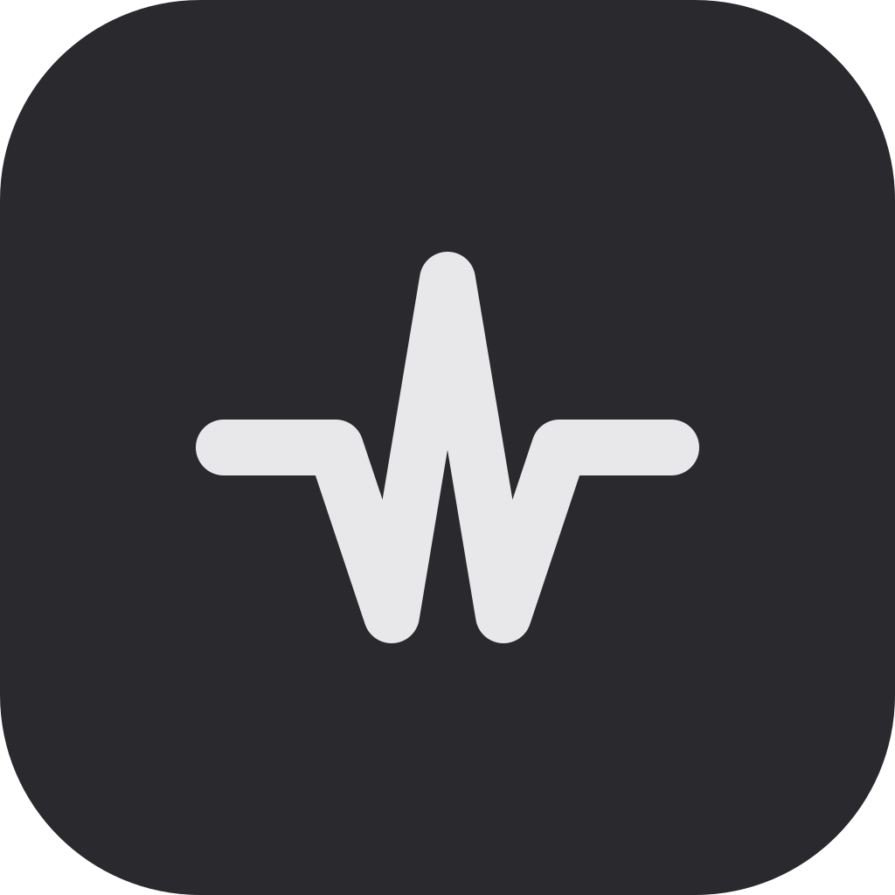
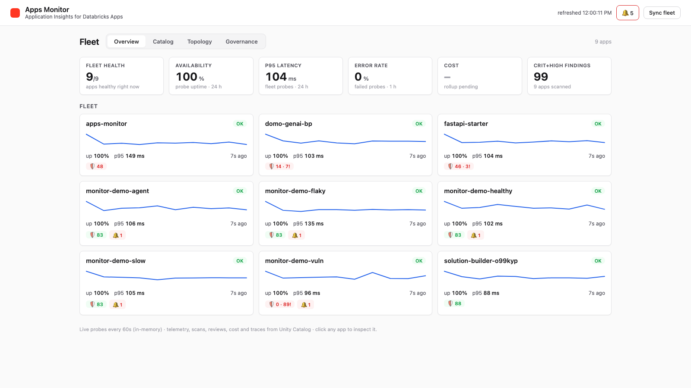
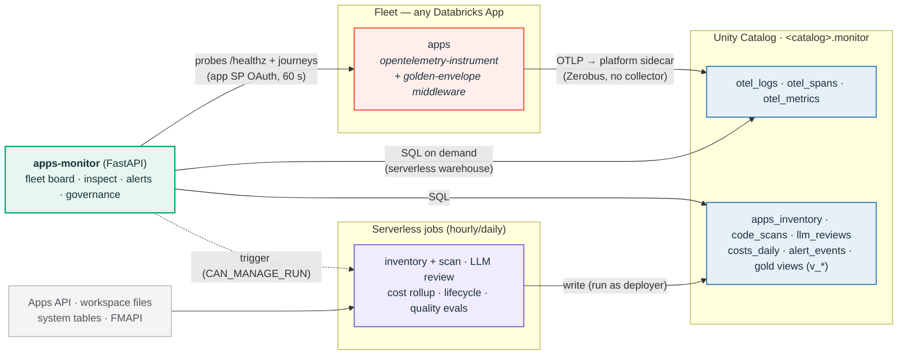

#  databricks-apps-monitor

**Apps Monitor — fleet health, cost, usage, and code risk for every Databricks App you run, in one place.**
It answers the questions you actually ask: _Is it up? Is it slow? What failed? What does it
cost — per app, per team, per user? Is the code production-ready?_

[](https://github.com/Paldom/databricks-apps-monitor/actions/workflows/ci.yml) [](LICENSE) 

<!-- GitHub renders inline video players only for web-editor uploads (user-attachments).
     For a true inline player: edit this README on github.com, drag apps-monitor-tour.mp4
     into the editor, and replace the link below with the generated URL. Until then the
     GIF preview autoplays and links to the full-quality mp4. -->

[](apps-monitor-tour.mp4)

> 🎬 **[Full-quality tour (mp4, 60 s)](apps-monitor-tour.mp4)** — fleet board, cost ranking,
> dependency topology, alerts, governance rules, and a full drill-down into one app
> (errors → traces → code & security → cost → operations).

Think Azure Application Insights, rebuilt on Databricks primitives — **nothing to host, no
collector, no vendor**. Apps ship OpenTelemetry through the platform into Unity Catalog;
serverless jobs add scans, LLM code review, and billing math; one FastAPI app serves the
whole picture. Existing apps are monitored with **zero changes**:

```bash
cp .env.example .env                                # instance config (catalog, admins…) — gitignored
scripts/deploy.sh monitor -t dev -p <profile>       # sources .env, deploys, prints the app URL
```



## Features

- **🩺 Reliability** — live fleet board (60 s probes: availability, p95, error rate, TTFB),
  synthetic journeys, capacity probing, incident timeline, anomaly detection vs baselines.
- **🔎 Deep diagnostics** — per-route request/latency/error telemetry, log explorer,
  fingerprinted error groups, dependency latency, full trace waterfalls with correlated logs.
- **🤖 GenAI observability** — agent runs and app requests in **one waterfall**
  (OTel ⟷ MLflow, cross-app), token/model trends, LLM error taxonomy, daily LLM-judge
  quality evals, in-app ★ feedback.
- **💰 FinOps** — exact compute $ per app from `system.billing.usage`, AI tokens attributed
  from the app's own spans (not estimates), budgets with burn alerts and **hard auto-stop**,
  30-day forecasts, chargeback by team.
- **🛡 Code risk** — source scans on every deployment (CVEs, secrets, smells, policy),
  Dependabot-style package analysis for Python **and** npm, and an agentic **CTO-style code
  review** with verdict + scores.
- **🏛 Governance** — inventory with automated grants, tagging, compliance export, audit
  trail, permission-drift alerts, one-click provisioning, embedded Genie Q&A, versioned
  AI/BI dashboard, dead-man watchdog.

Full capability → mechanism → table reference: [docs/FEATURES.md](docs/FEATURES.md).
A five-app **demo fleet** (healthy / flaky / slow / vuln / agent) exercises everything,
including a CVE-bait app the LLM reviewer rejects and two real MLflow-traced agents.

## Get started

Prerequisites: Databricks CLI ≥ v0.283 (authenticated profile), a workspace with
serverless compute + Unity Catalog, a catalog you can create schemas in. Any cloud.

```bash
# 1) toolkit: schema, monitor app, jobs, dashboard, alerts
scripts/deploy.sh monitor -t dev -p <profile>                # instance values come from .env (BUNDLE_VAR_*)
databricks bundle run monitor        -t dev -p <profile>     # start the app (prints its URL)
databricks bundle run inventory_scan -t dev -p <profile>     # snapshot fleet + bootstrap grants

# 2) optional: the 5-app demo fleet (monitor_url comes from .env)
scripts/deploy.sh demos -t dev -p <profile>
cd example-apps
for a in healthy flaky slow vuln agent; do databricks bundle run $a -t dev -p <profile>; done
```

Open the printed URL — the fleet board is live. Instance values (catalog, admin emails,
Genie space, demo `monitor_url`, workspace list) live in the uncommitted `.env` as
`BUNDLE_VAR_*` and flow into the app via bundle variables — nothing identifying is in the
repo. Other variables (`schema`, `warehouse_id`, `review_model`, `night_tz`, …) are
overridable with `--var`; the dashboard dataset queries are the one place DABs variables
can't reach.

## Add your apps

Every app in the workspace is picked up with **zero changes**: probes, inventory, source
scan, package analysis, LLM review, cost, audit. Telemetry depth is a two-step opt-in
(full contract: [docs/INSTRUMENTATION.md](docs/INSTRUMENTATION.md)):

1. **Export telemetry** on the app resource, and start the app instrumented:

   ```yaml
   # resources/<your-app>.app.yml
   telemetry_export_destinations:
     - unity_catalog:
         logs_table: <catalog>.monitor.otel_logs
         traces_table: <catalog>.monitor.otel_spans
         metrics_table: <catalog>.monitor.otel_metrics
   ```

   ```yaml
   # app.yaml
   command: [opentelemetry-instrument, python, main.py]
   env:
     - { name: OTEL_SERVICE_NAME, value: <your-app-name> } # = tenant key in the shared tables
     - { name: OTEL_TRACES_EXPORTER, value: otlp }
     - { name: OTEL_METRICS_EXPORTER, value: otlp }
     - { name: OTEL_LOGS_EXPORTER, value: otlp }
   ```

2. **Install the golden-envelope middleware** (request/session/user correlation + ★
   feedback route): `pip install monitor-middleware`, or copy the single file
   [`sdk/monitor_middleware.py`](sdk/monitor_middleware.py) (byte-identical), then:

   ```python
   from monitor_middleware import install
   app = install(FastAPI())
   ```

Agent apps additionally set `MLFLOW_ENABLE_DUAL_EXPORT=true` + an `experiment` resource
binding — that's what unlocks the unified waterfalls below. Optional: a synthetic journey
(`app/journeys.json`), tags/budget/auto-stop (Governance page).

## Who it's for

| Persona                     | The question                                         | Where they live                                          |
| --------------------------- | ---------------------------------------------------- | -------------------------------------------------------- |
| **Tech lead / eng manager** | "Is my fleet OK — would I sign off this app?"        | Dashboard, per-app scorecard, review verdicts            |
| **Platform / ops**          | "What needs me now, what can I automate?"            | Alert center, anomaly + drift alerts, auto-stop policies |
| **Developer / support**     | "Why did it 500 at 14:32, what did that request do?" | Error groups → trace waterfall → correlated logs         |
| **FinOps / governance**     | "Who spends what, is anything out of policy?"        | Chargeback, budgets, compliance matrix, Genie Q&A        |

The UI mirrors these journeys: a fleet **Dashboard** (Overview · Catalog · Topology ·
Governance · Ask Genie) and a per-app **Inspect** view (scorecard → Investigate / Assess /
Operate).

## How it works



Three design rules keep it cheap: **native pipeline over custom ingestion** (no collector —
apps ship OTel through the platform into shared tables, `service_name` = tenant key);
**warm data in memory, history in UC** (the live board never wakes the SQL warehouse;
probe results are themselves OTel telemetry, so history is free); **jobs write, the app
reads** (jobs run as the deployer; the app's service principal gets narrow grants,
bootstrapped by the inventory job itself — permissions table in
[docs/FEATURES.md](docs/FEATURES.md#permissions-model)).

### The correlation model (why the numbers can be trusted)

Everything joins on a small, deliberate key set:

| Key                                      | Set by                                 | Joins                                                        |
| ---------------------------------------- | -------------------------------------- | ------------------------------------------------------------ |
| `service_name` (= app name)              | platform exporter                      | every span/log/metric → its app                              |
| `trace_id`                               | OTel SDK + W3C `traceparent`           | request → spans → logs, across apps                          |
| `app.client_request_id`                  | golden-envelope middleware             | browser request → app spans → MLflow agent trace             |
| `session.id`, `user.id_hash`             | middleware (cookie + hashed principal) | usage + per-user cost share, pseudonymous                    |
| `gen_ai.usage.*`, `gen_ai.request.model` | the app's own LLM spans                | tokens → app/request/session/user — **exact, not estimated** |

The FinOps punchline: token counts originate in the app's own telemetry, where the LLM
call happens — so AI cost attribution needs no guesswork. The cost job lines this
**bottom-up** signal up against **top-down** billing (`system.billing.usage` × list
prices) in one `costs_daily` row per app per day; budgets, forecasts, and chargeback all
read that single reconciled surface.

### Unified tracing: OTel ⟷ MLflow

With `MLFLOW_ENABLE_DUAL_EXPORT=true`, MLflow traces land **both** in the experiment
(MLflow UI) and — as typed spans carrying `mlflow.spanType` / `mlflow.traceRequestId` — in
`otel_spans`, inside the _same OTel trace_ as the FastAPI request that triggered them. One
waterfall walks HTTP request → AGENT → TOOL → LLM spans — across apps when a tool calls
another app — with token counts and correlated logs on every row, plus a deep link into
the MLflow UI. Without the flag, the Apps-injected OTLP endpoint silently redirects MLflow
export away from the experiment; with it you get both worlds and one join key end to end.

### Platform behaviors the toolkit already handles

> [!WARNING]
> **Do not pin `OTEL_EXPORTER_OTLP_ENDPOINT`.** The Apps sidecar listens on
> **`localhost:4314`** (injected automatically), not the documented 4317 — pinning 4317
> silently kills span/metric export while logs keep flowing.

Stopped apps still answer HTTP 200 (detection uses the Apps API, not status codes); the
apps proxy intercepts `GET /healthz`; job-runtime tokens are rejected by app URLs (so
probes run _inside_ the monitor under its own service principal); MLflow trace content is
read via REST because app containers can't reach artifact storage. Full learnings:
[docs/BUILDLOG.md](docs/BUILDLOG.md).

## Project status & layout

Actively developed — 21 deployed-and-verified iterations against a real workspace
([docs/BUILDLOG.md](docs/BUILDLOG.md)); metric-by-metric honesty audit in
[docs/METRICS-AUDIT.md](docs/METRICS-AUDIT.md). The repo is two bundles: the toolkit
(`databricks.yml`: app + jobs + schema + dashboard + alerts) and `example-apps/` (the demo
fleet), plus the middleware as both a wheel (`src/monitor_middleware/`) and a copy-in file
(`sdk/`), with docs under `docs/`.

Contributing: [CONTRIBUTING.md](CONTRIBUTING.md) · Support: [SUPPORT.md](SUPPORT.md) ·
Security: [SECURITY.md](SECURITY.md) · License: [MIT](LICENSE)
