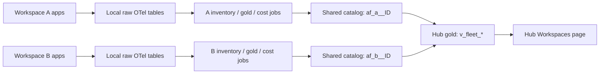

# Feeder/hub federation (S12)

`deployment_mode` defaults to `standalone`; existing single-workspace queries and
probes keep their behavior. Set bundle variables in the uncommitted `.env`, then use
`scripts/deploy.sh monitor -t <target> -p <profile>` when deployment is authorized.

| Mode       | Jobs                                                                                                    | Monitor                                                      |
| ---------- | ------------------------------------------------------------------------------------------------------- | ------------------------------------------------------------ |
| standalone | Local inventory, aggregates and priced costs                                                            | Local live probes and UI                                     |
| feeder     | Local jobs also publish to `hub_catalog.af_<workspace_name>__<workspace_id>`                            | Local probes/journeys stay on; local trace drill-down        |
| hub        | Gold discovers feeder schemas and regenerates `v_fleet_*` views; cost job defers pricing to those views | Workspaces page with a workspace filter and workspace column |

Example feeder variables (the hub uses the same catalog and `deployment_mode=hub`):

```dotenv
BUNDLE_VAR_deployment_mode=feeder
BUNDLE_VAR_hub_catalog=shared_monitoring
BUNDLE_VAR_workspace_name=west_eu
```

The workspace ID comes from the job's `WorkspaceClient`. Names are normalized to
lowercase letters, digits and underscores; the ID prevents collisions. An omitted
name uses the workspace host's first label. Keep the label stable: renaming it
creates a new schema, so retire the old schema before using the new name at the hub.



This implements the apps-factory **direct** transport convention with native UC
writes. `af_common` is not a dependency of this repository. Delta-to-Delta sharing
transport across metastores is deferred. Use a shared metastore/catalog accessible
to both feeder and hub workspaces in the same region. Apps telemetry export
destinations must remain in their app workspace's region. Raw spans, logs, metrics,
user hashes and trace payloads stay in each feeder's local schema.

Published objects:

| Object           | Write contract / key                                                                                  |
| ---------------- | ----------------------------------------------------------------------------------------------------- |
| `apps_current`   | Atomic overwrite with the current inventory scan, including an empty fleet; deleted apps disappear    |
| `apps_history`   | MERGE on `(workspace_id, name, snapshot_ts)`; retries are idempotent                                  |
| `apps_inventory` | View alias of `apps_current`                                                                          |
| `agg_app_daily`  | MERGE on `(workspace_id, date, name, traffic_kind)`; preserved historical aggregates and HLL sketches |
| `costs_daily`    | DBUs only, plus date/name/workspace metadata; MERGE on `(workspace_id, date, name)`                   |
| `alert_events`   | Retained MERGE on `(workspace_id, source, rule, app, ts, state)`                                      |

All tables have comments and a `workspace_id STRING` column. The hourly hub gold
job discovers `af_*__<numeric-id>` schemas using `information_schema.tables`, unions
each available object separately, and replaces empty views when no feeders remain.
The hub owns `v_fleet_apps_current`, `v_fleet_agg_app_daily`,
`v_fleet_costs_unpriced`, `v_fleet_costs_daily`, `v_fleet_alert_events` and
`v_fleet_alerts_open`. Refresh gold after adding/removing a feeder. Repeated app
names are distinct by workspace ID; never group or join only by app name.

Billing is account-wide. Feeders filter `system.billing.usage` to their own workspace
and publish DBUs without prices or AI dollars/tokens. The hub joins those keys to
account billing and `system.billing.list_prices` exactly once. Missing billing or
price coverage stays null. Do not sum standalone priced costs into hub costs.
The view uses billing's SKU/cloud/time-specific prices; an average daily price
would incorrectly combine SKUs or a mid-day price change. AI pricing remains a
local feature until its separate model-price contract is available.

Each feeder keeps its own monitor service principal and local probes. The hub does
not send its token to other workspaces. Use the existing `MONITOR_WORKSPACES` links
to open a feeder monitor for live status, SLOs and trace drill-down. The Workspaces
page shows inventory freshness and daily totals, not remote live availability.
The authenticated `/status` and local MCP drill-down tools describe the monitor's
own workspace; aggregate fleet data is available at `/api/reach/fleet?workspace_id=...`.

## Grants and rollout

The feeder job identity needs `USE CATALOG`, `CREATE SCHEMA` on the hub catalog
(or a pre-created feeder schema), and `USE SCHEMA`, `CREATE TABLE`, `MODIFY`,
`SELECT` on its own feeder schema. Grant only that schema to each feeder writer.
The hub gold job identity needs `USE CATALOG`, `USE SCHEMA`, `SELECT` on every feeder
schema, read access to account billing/list prices, and ownership/create rights on
the hub's monitor schema. Ensure it can discover all intended feeder tables; UC
information-schema discovery is privilege filtered. Use catalog workspace bindings
to allow access from the participating workspaces.

`inventory_scan.grant_monitor_access` grants the monitor SP inherited `SELECT` on
its local monitor schema, including newly created `v_fleet_*` views. The view owner
must retain its underlying grants. The monitor receives `MODIFY` on local
`synthetic_runs` for internal journey evidence. No direct write grant to a remote
feeder is needed by the monitor app.

Run feeder inventory, cost and gold once, then hub inventory/gold, before reviewing
the Workspaces page. Verify two apps with the same name remain separate and that
rerunning feeder jobs does not increase daily totals. Deploy/runtime verification
requires a chosen profile and was not performed as part of the local implementation.

## External synthetics (S11)

The hourly inventory job invokes the table owner's idempotent migration for
`synthetic_runs`; the paused serverless browser job is superseded. Internal HTTP
journeys and the external runner write `workspace_id`, `vantage`, `run_id` and
`failure_stage` (`auth`, `dns`, `http`, `assertion`, or null on success). Writes are
idempotent per workspace/run/app/journey/step/vantage. Legacy browser rows have a
separate vantage and cannot satisfy the two-vantage rule.

Configure a dedicated OAuth M2M service principal with workspace access. Set
`BUNDLE_VAR_external_sp` to its application ID. Inventory grants it `CAN_USE` on
the fleet (including the monitor), UC `SELECT`/`MODIFY` on `synthetic_runs`, and
read/write access to the `ui_tests` volume. An operator must also grant the SP
`CAN_USE` on the selected SQL warehouse and permission to list the target apps.

GitHub Actions secrets: `SYNTHETICS_HOST`, `SYNTHETICS_CLIENT_ID`,
`SYNTHETICS_CLIENT_SECRET`. Repository variables: `EXTERNAL_SYNTHETICS_ENABLED=true`,
`SYNTHETICS_WAREHOUSE_ID`, `SYNTHETICS_WORKSPACE_ID`, `MONITOR_CATALOG`, and optional
`MONITOR_SCHEMA` (default `monitor`). Runs are scheduled every 15 minutes. A failed
OAuth exchange or result upload fails the run; SQL cannot receive a failure row
while its own authentication/network is unavailable. Sanitized results remain as
a private Actions artifact, and missing vantage evidence stays unknown. Configure
workflow failure notifications to cover this independent dead-man signal.

Plain HTTP journeys reuse `app/journeys.json`, including named content/status
assertions. Multiple journeys per app are supported. Paths are app-relative,
redirects are not followed with credentials, and `/healthz` is rejected because the
Apps proxy intercepts it. `within_budget` records latency-budget performance
separately from the functional pass/fail result.

Optional Playwright: set `SYNTHETICS_PLAYWRIGHT=true` and add journeys with
`"kind": "playwright"`. Steps support `path`, `expect_status`, `expect_contains`,
`expect_selector`, `click`, or `selector` plus `fill`. Internal journeys skip these;
browser-only journeys are recorded but cannot alone produce a corroborated alert.
Common HTTP journeys provide matching evidence. App/name pairs must be unique.
Browser credentials are added only to requests for the app origin. Set
`SYNTHETIC_ARTIFACT_VOLUME` to override the default
`/Volumes/<catalog>/<schema>/ui_tests` destination for result JSON and screenshots.
Screenshots are never included in the public Pages artifact.

`journey_failed` fires only after two distinct consecutive failed runs of the same
journey from **each** of `internal` and `external`. Only the last two hours count.
Multiple steps or SQL delivery retries do not count as additional runs. An observed
success breaks the failure streak; missing/stale evidence does not clear an open
incident. Existing local probe rules (`app_down`, latency, error rate) remain local
signals and retain their behavior.

A `step=-1` completion row is written after each journey's steps. Only completion
rows participate in alert evidence, so a partially uploaded journey cannot look
like a successful run and prematurely resolve an incident.

## MCP and status (S10, S13)

`/mcp` is a stateless Streamable HTTP endpoint using the official Python `mcp`
runtime dependency. Its seven tools are `fleet_summary`, `app_overview`,
`error_groups`, `trace`, `cost_summary`, `open_alerts`, `slo_status`. They are
read-only wrappers; no mutation tools are registered. Configure coding agents with
the monitor URL ending in `/mcp` and an Apps OAuth token. Apps ingress authenticates
the caller and provides identity headers; the process must not be exposed directly
through a proxy that accepts caller-supplied identity headers. Each process allows
60 MCP HTTP requests per caller per minute (including protocol requests), with a
bounded caller cache. This is a simple per-instance limit, not a distributed quota.

`/status` and `/api/status` require the same workspace identity. Status uses the
existing 24-hour in-memory probe history, with hourly uptime bars and grey gaps
after a restart. Probe uptime describes the existing proxy-oriented availability
check; functional journey failures are separate incidents. Open incidents come
from `v_alerts_open`. SLOs (`slo_specs`, `sli_5m`) and active maintenance
(`alert_mutes`) appear when deployed; absent tables report unavailable, never a
fabricated green state. The SLO query follows roadmap §5 S2's name/slo/bucket contract.

Public Pages publishing is **off by default**, in a separate job. Enable Pages with
the GitHub Actions source, set `PUBLISH_STATUS=true` or the manual `publish_status`
input, add the `MONITOR_URL` secret, and configure `PUBLIC_STATUS_APPS` as a JSON
object mapping internal app names to approved public labels. An empty map publishes
no apps. The snapshot includes only labels, enumerated state and hourly uptime;
it omits workspace IDs, URLs, identities, incident text, maintenance reasons,
SLO names and raw probe results. The HTML shows a stale-snapshot warning after
45 minutes. Publishing permissions (`pages: write`, `id-token: write`) belong only
to the publish job; checks use `contents: read`.
